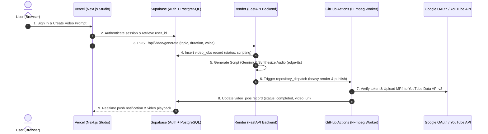

# 🚀 PostMatic: Full-Stack Production Deployment & Setup Guide

This guide walks you through deploying the complete **PostMatic** ecosystem to free-tier cloud platforms:
- **Frontend:** Next.js 16 on **Vercel**
- **Backend API:** FastAPI on **Render** (or Railway)
- **Database & Auth:** **Supabase** (PostgreSQL + RLS + GoTrue)
- **Heavy Cloud Compute:** **GitHub Actions** (FFmpeg H.264 video rendering & YouTube publishing)
- **AI & Media APIs:** Google Gemini, Microsoft edge-tts, Pexels CDN, YouTube Data API v3

---

## 📑 Table of Contents
1. [Architecture & Flow](#1-architecture--flow)
2. [Step 1: Supabase Configuration (Database & Auth)](#step-1-supabase-configuration)
3. [Step 2: Google Cloud Console (YouTube OAuth 2.0)](#step-2-google-cloud-console-setup)
4. [Step 3: Backend API Deployment on Render](#step-3-backend-api-deployment-on-render)
5. [Step 4: Frontend Deployment on Vercel](#step-4-frontend-deployment-on-vercel)
6. [Step 5: GitHub Actions Secrets (Cloud Rendering Pipeline)](#step-5-github-actions-secrets-configuration)
7. [Step 6: End-to-End Production Verification](#step-6-end-to-end-production-verification)

---

## 1. Architecture & Flow

---

## Step 1: Supabase Configuration

### 1.1 Execute Database Schema Migration
1. Log into your [Supabase Dashboard](https://supabase.com/dashboard).
2. Select your project (e.g., `tetrfsdsnvfgrkfeiybc`).
3. In the left sidebar, click **SQL Editor** -> **New Query**.
4. Copy the entire contents of [`supabase_schema.sql`](./supabase_schema.sql) and paste it into the query editor.
5. Click **Run** (or `Ctrl+Enter`).
6. Confirm that the following tables and extensions are created:
   - `video_jobs` (with indexes and RLS policies)
   - `social_accounts` (with unique `user_id` + `platform` constraint)

### 1.2 Configure Supabase Authentication Redirect URLs
1. In Supabase, go to **Authentication** -> **URL Configuration**.
2. Set **Site URL** to your frontend URL:
   - For local development: `http://localhost:3001`
   - For production: `https://your-app-name.vercel.app`
3. Under **Redirect URLs**, add the following URLs (click **Add URL**):
   - `http://localhost:3001/auth/callback`
   - `https://your-app-name.vercel.app/auth/callback`
4. Click **Save**.

### 1.3 Retrieve Supabase API Credentials
Go to **Project Settings** -> **API**:
- `Project URL` -> `SUPABASE_URL` (e.g. `https://tetrfsdsnvfgrkfeiybc.supabase.co`)
- `Project API keys` -> `anon` (public) -> `SUPABASE_KEY`
- `Project API keys` -> `service_role` (secret) -> `SUPABASE_SERVICE_ROLE_KEY`

---

## Step 2: Google Cloud Console Setup

### 2.1 Enable YouTube Data API v3
1. Open [Google Cloud Console](https://console.cloud.google.com/).
2. Select or create your Google Cloud Project.
3. In the top search bar, search for **YouTube Data API v3** and click **Enable**.

### 2.2 Configure OAuth Consent Screen
1. Go to **APIs & Services** -> **OAuth consent screen**.
2. Select User Type: **External** -> Click **Create**.
3. Fill in App Information:
   - **App name:** `PostMatic Studio`
   - **User support email:** Your email address
   - **Developer contact information:** Your email address
4. Click **Save and Continue**.
5. Under **Scopes**, click **Add or Remove Scopes**, and select:
   - `.../auth/youtube.upload` (Upload YouTube videos)
   - `.../auth/youtube.readonly` (View YouTube account details)
6. Under **Test users**, add your personal Google email address (the channel owner account).
7. Click **Save and Continue**.

### 2.3 Configure OAuth 2.0 Web Client ID
1. Go to **APIs & Services** -> **Credentials**.
2. Click **+ Create Credentials** -> **OAuth client ID**.
3. Application type: **Web application**.
4. Name: `PostMatic Web Client`.
5. **Authorized JavaScript origins:**
   - `http://localhost:3001`
   - `https://your-app-name.vercel.app`
6. **Authorized redirect URIs:**
   - `http://localhost:8000/api/social/youtube/callback`
   - `https://your-backend-name.onrender.com/api/social/youtube/callback`
7. Click **Create**.
8. Copy your **Client ID** (`GOOGLE_CLIENT_ID`) and **Client Secret** (`GOOGLE_CLIENT_SECRET`).

---

## Step 3: Backend API Deployment on Render

### 3.1 Create Web Service
1. Log into [Render.com](https://dashboard.render.com/).
2. Click **New +** -> **Web Service**.
3. Select **Build and deploy from a Git repository** -> Connect `https://github.com/isgathoni35/post-matic`.
4. Configure service settings:
   - **Name:** `post-matic-backend` (or your preferred name)
   - **Region:** Frankfurt (EU) or Oregon (US)
   - **Branch:** `main`
   - **Root Directory:** *(leave blank / root)*
   - **Runtime:** `Python 3`
   - **Build Command:** `pip install -r requirements.txt`
   - **Start Command:** `python -m uvicorn api.main:app --host 0.0.0.0 --port $PORT`
   - **Instance Type:** `Free`

### 3.2 Configure Environment Variables on Render
In the Render Web Service settings, go to **Environment** and add the following key-value pairs:

| Key | Value Description | Example / Value |
| :--- | :--- | :--- |
| `PYTHON_VERSION` | Python runtime version | `3.12.0` |
| `GEMINI_API_KEY` | Google AI Studio API key | `AQ.Ab8RN6K3...` |
| `PEXELS_API_KEY` | Pexels Developer API key | `Vg0A6C7z...` |
| `SUPABASE_URL` | Supabase Project URL | `https://tetrfsdsnvfgrkfeiybc.supabase.co` |
| `SUPABASE_KEY` | Supabase anon public key | `eyJhbGciOi...` |
| `SUPABASE_SERVICE_ROLE_KEY` | Supabase service_role key | `eyJhbGciOi...` |
| `GOOGLE_CLIENT_ID` | Google OAuth Client ID | `673806725236-...apps.googleusercontent.com` |
| `GOOGLE_CLIENT_SECRET` | Google OAuth Client Secret | `GOCSPX-...` |
| `GOOGLE_REDIRECT_URI` | Render callback endpoint | `https://post-matic-backend.onrender.com/api/social/youtube/callback` |
| `FRONTEND_URL` | Your Vercel frontend URL | `https://post-matic-frontend.vercel.app` |
| `GITHUB_PAT` | GitHub Personal Access Token (for cloud compute offload) | `ghp_yourTokenHere...` |
| `GITHUB_REPO` | GitHub repository path | `isgathoni35/post-matic` |

Click **Save Changes** to trigger automatic build and deployment.

---

## Step 4: Frontend Deployment on Vercel

### 4.1 Import Repository
1. Log into [Vercel](https://vercel.com/dashboard).
2. Click **Add New...** -> **Project**.
3. Select and import `isgathoni35/post-matic`.

### 4.2 Configure Build & Output Settings
1. In the project setup wizard, expand **Root Directory**:
   - Click **Edit** -> Select `web` directory -> Click **Continue**.
2. **Framework Preset:** `Next.js` (automatically detected).

### 4.3 Configure Environment Variables on Vercel
Add the following 3 Environment Variables under **Environment Variables**:

| Name | Description | Value |
| :--- | :--- | :--- |
| `NEXT_PUBLIC_SUPABASE_URL` | Supabase Project URL | `https://tetrfsdsnvfgrkfeiybc.supabase.co` |
| `NEXT_PUBLIC_SUPABASE_ANON_KEY` | Supabase public anon key | `eyJhbGciOi...` |
| `NEXT_PUBLIC_API_URL` | Your live Render backend URL | `https://post-matic-backend.onrender.com` |

> [!NOTE]
> In Vercel, save these as standard **Environment Variables / Configuration** (not Sensitive/Secret). Next.js bundles variables prefixed with `NEXT_PUBLIC_` directly into the public browser client so the authentication and API clients can communicate with Supabase and FastAPI.

Click **Deploy** (or **Redeploy** with *"Clear build cache"* if updating).

---

## Step 5: GitHub Actions Cloud Compute & Secrets Configuration

To execute heavy FFmpeg video rendering without crashing Render's free 512 MB tier, PostMatic dispatches generation jobs to **GitHub Actions** (providing an ephemeral 7 GB RAM virtual machine).

### 5.1 Generate GitHub Personal Access Token (PAT)
1. Go to [GitHub Developer Settings -> Personal access tokens (classic)](https://github.com/settings/tokens).
2. Click **Generate new token** -> **Generate new token (classic)**.
3. Note: `PostMatic Cloud Runner Dispatcher`.
4. Expiration: Select `90 days` (or `No expiration`).
5. Select the following scopes:
   - [x] **`repo`** (Full control of private repositories)
   - [x] **`workflow`** (Update GitHub Action workflows)
6. Click **Generate token**.
7. Copy the token string (e.g. `ghp_...`).
8. Add this token as **`GITHUB_PAT`** and your repository (`isgathoni35/post-matic`) as **`GITHUB_REPO`** in your [Render Web Service Environment Settings](https://dashboard.render.com).

### 5.2 Configure GitHub Repository Secrets
The GitHub Actions runner needs API keys to download stock media, generate scripts, and upload to YouTube:

1. Open your repository: [https://github.com/isgathoni35/post-matic](https://github.com/isgathoni35/post-matic)
2. Click **Settings** -> **Secrets and variables** -> **Actions**.
3. Under **Repository secrets**, click **New repository secret** for each item:

| Secret Name | Value |
| :--- | :--- |
| `GEMINI_API_KEY` | Your Google AI Studio API key |
| `PEXELS_API_KEY` | Your Pexels Developer API key |
| `SUPABASE_URL` | `https://tetrfsdsnvfgrkfeiybc.supabase.co` |
| `SUPABASE_KEY` | Supabase anon key |
| `SUPABASE_SERVICE_ROLE_KEY` | Supabase service_role key |
| `GOOGLE_CLIENT_ID` | Google OAuth Client ID |
| `GOOGLE_CLIENT_SECRET` | Google OAuth Client Secret |
| `GOOGLE_REDIRECT_URI` | `https://post-matic-backend.onrender.com/api/social/youtube/callback` |
| `FRONTEND_URL` | `https://post-matic-frontend.vercel.app` |

---

## Step 6: Keep-Alive Cron Setup (Prevent Render Inactivity Sleep)

Render's free tier spins down the web service after **15 minutes of inactivity**, resulting in a 50-second cold-start delay when the next request arrives. You can prevent this using either or both methods below:

### Method A: Built-in GitHub Actions Cron (Zero External Accounts)
A scheduled workflow has been added to `.github/workflows/keep_alive.yml`.
* It runs automatically every **14 minutes** (`*/14 * * * *`).
* It sends a fast HTTP ping to `https://post-matic.onrender.com/health`.
* To test it manually anytime:
  1. Go to your repo -> **Actions** -> **Keep Render Backend Awake**.
  2. Click **Run workflow** -> **Run workflow**.

### Method B: External Pinger via Cron-Job.org (Recommended for 100% Uptime)
External cron services have 0 jitter and run continuously 24/7 for free:
1. Sign up for free at [https://cron-job.org/](https://cron-job.org/).
2. Click **Create cronjob**.
3. **Title:** `PostMatic Render Keep-Alive`
4. **URL:** `https://post-matic.onrender.com/health`
5. **Execution schedule:** Every `10 minutes` (or `14 minutes`).
6. Click **Create**.

---

## Step 7: End-to-End Production Verification

1. **Access Studio:** Navigate to your live Vercel URL (`https://your-app.vercel.app`).
2. **Auth Verification:** Confirm unauthenticated users are redirected to `/login`. Sign in using Email/Password.
3. **Connect YouTube Account:**
   - In the sidebar, click **Social Accounts**.
   - Click **Connect YouTube Channel** -> Complete Google OAuth consent.
   - Confirm channel badge shows **Connected** with offline token active.
4. **Generate Vertical Video:**
   - In **Studio Console**, type a prompt or pick a starter chip.
   - Select duration (e.g. `25s`) and preferred voice actor.
   - Click **Generate & Render 9:16 Video**.
5. **Real-time Pipeline Tracking:**
   - Observe live stage indicators (*Scripting* -> *Audio Synthesis* -> *Media Sourcing* -> *Assembly*).
   - Once completed, preview the final 1080x1920 MP4 with synchronized captions in the smartphone canvas.
6. **Publishing / Download:**
   - Download the rendered MP4 file.
   - View your asset in **Render Library** and inspect telemetry in **Engine Logs**.
